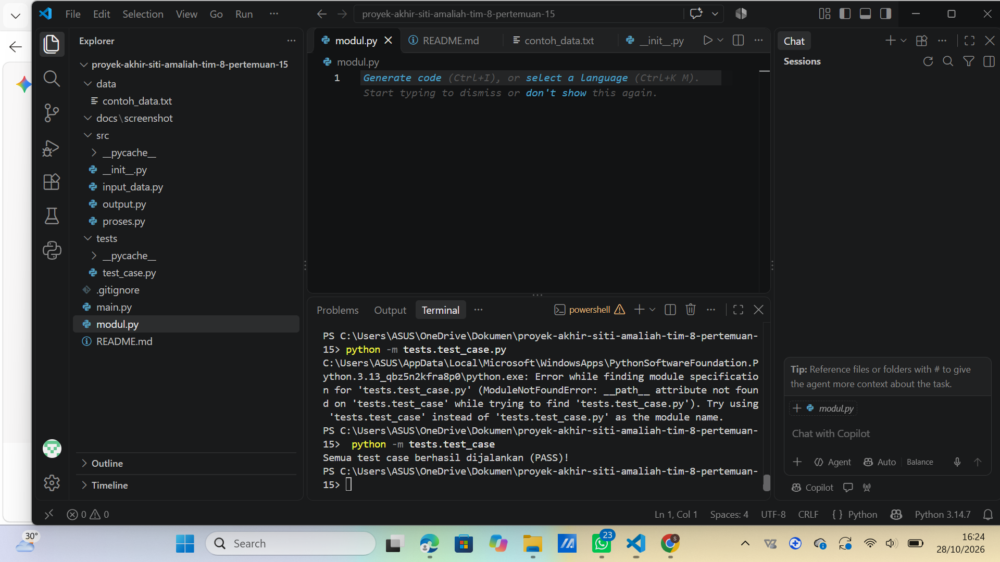

# 📊 Student Grade Analysis (Analisis Nilai Siswa)

Proyek ini adalah aplikasi berbasis Python untuk menganalisis data nilai siswa secara modular. Program dibuat untuk memenuhi tugas **Pertemuan 15 (Proyek Akhir)** dengan struktur kode yang rapi, teruji, dan memiliki penanganan kesalahan input (*error handling*).

---

## 📁 Struktur Proyek

```text
proyek-akhir-Siti-Amaliah-tim-8-pertemuan-15/
│
├── src/
│   ├── __init__.py
│   ├── input_data.py
│   ├── proses.py
│   └── output.py
│
├── tests/
│   └── test_sederhana.py
│
├── data/
│   └── contoh_data.txt
│
├── docs/
│   └── screenshot/
│       ├── 01_fitur_utama.png
│       └── 02_pengujian_assert.png
│
├── main.py
├── .gitignore
└── README.md
```

---

## 🚀 Fitur Utama

1. **Input Data Interaktif**: Memasukkan data nilai secara manual satu per satu hingga mengetik `selesai`.
2. **Penanganan Kesalahan (Error Handling)**: Program menolak input non-angka atau angka di luar rentang $0 - 100$ tanpa membuat aplikasi *crash*.
3. **Analisis Statistik**:
   - Menghitung nilai rata-rata (*mean*).
   - Menentukan nilai tertinggi dan terendah.
   - Menghitung jumlah siswa yang lulus (nilai $\ge 60$).
4. **Pengujian Otomatis (Unit Testing)**: Menggunakan pernyataan `assert` untuk memvalidasi akurasi fungsi perhitungan.

---

## 💻 Cara Menjalankan Aplikasi

### 1. Menjalankan Program Utama
Buka terminal PowerShell di folder proyek, lalu jalankan:
```powershell
python main.py
```

### 2. Menjalankan Unit Testing
Untuk menguji kebenaran fungsi logika:
```powershell
python -m tests.test_sederhana
```

---

## 📸 Dokumentasi Pengujian

### 1. Eksekusi Program Utama & Handling Error


### 2. Pengujian Unit Test (Assert PASS)


---

## 🛠️ Deskripsi Modul

- `src/input_data.py`: Meminta input nilai dari pengguna dan memvalidasi tipe data.
- `src/proses.py`: Mengolah data statistik (rata-rata, min, max, kelulusan).
- `src/output.py`: Menampilkan ringkasan hasil analisis ke layar terminal.
- `main.py`: Menghubungkan alur kerja utama seluruh modul.